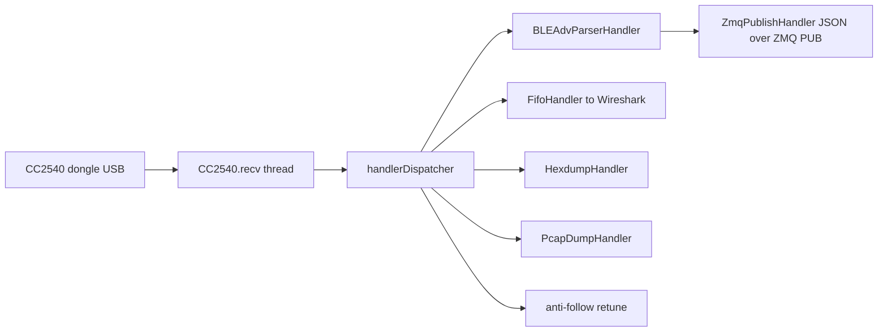

# gamble

A Python tool that connects to a **CC2540 USB dongle** (Texas Instruments BLE packet sniffer, USB ID `0451:16b3`), captures Bluetooth Low Energy packets, pipes them to Wireshark, saves them as pcap or hexdump, and optionally publishes parsed BLE events as JSON over ZeroMQ for a live dashboard.

Based on `ccsniffpiper` by Andrew Dodd, itself a mashup of `ccsniffer` (George Oikonomou) and `sensniffer` (Christian Panton). Licensed under GPL v3 or later.

## Features

- Live BLE capture from one or more CC2540 dongles on any advertising channel (37, 38, 39).
- Stream frames to Wireshark through a named pipe (FIFO) as pcap with the `LINKTYPE_BLUETOOTH_LE_LL_WITH_PHDR` link type, including RSSI and CRC status.
- Save captures as pcap (`-p`) or hexdump (`-x`).
- Parse advertising PDUs and extract:
  - Advertiser address (from `ADV_IND`, `ADV_DIRECT_IND`, `ADV_NONCONN_IND`, `ADV_SCAN_IND`, `SCAN_RSP`, `SCAN_REQ`, `CONNECT_REQ`)
  - Local name (shortened/complete, AD types 0x08/0x09)
  - TX power, manufacturer-specific data, 16/32/128-bit service UUIDs and service data
- Parse **CONNECT_REQ** and extract the full connection recipe: access address, CRC init, hop increment, channel map, connection interval, latency, timeout, and sleep clock accuracy.
- Publish everything as JSON on a ZMQ PUB socket (`-z`), so one aggregator (e.g. a laptop) can subscribe to several sniffers (e.g. one Raspberry Pi + CC2540 per advertising channel) and merge the feeds into a single live view.
- Select a specific dongle when multiple are plugged in (`--usb-bus-address`).

## Scope and limitations

The stock CC2540 sniffer firmware only tunes to the three BLE advertising channels (37/38/39). It cannot follow a connection onto the data channels. From a `CONNECT_REQ` you get everything an observer would need to compute the hop sequence (access address, hop increment, channel map, timing), which is what gets published as a "new connection" event, but actually following the data-channel hopping live requires additional hardware (e.g. an Ubertooth-class sniffer) synced to that recipe.

Two experimental options exist for firmware variants that do follow connections:

- `--trailing-byte-is-channel`: interpret a byte after the PDU in the raw USB frame as the per-packet data channel. Off by default; verify with `-D DEBUG` (look for "Trailing bytes..." log lines) before trusting it.
- `--anti-follow`: when a `CONNECT_REQ` is seen and the firmware hops onto data channels, immediately retune back to the configured advertising channel. Best-effort only; there is no documented "disable follow" command for this firmware. `--anti-follow-cooldown` (default 0.5 s) limits retune frequency.

## Requirements

- Python 3
- `pyusb` (`pip install pyusb`)
- `pyzmq` (optional, only for ZMQ publishing; `pip install pyzmq --break-system-packages` on Debian/Ubuntu)
- A CC2540 USB dongle with sniffer firmware, and permission to access USB devices (a udev rule, or run as root)

## Usage

```text
python3 gamble.py [options]
```

### Input options

| Option                       | Description                                            |
| ---------------------------- | ------------------------------------------------------ |
| `-c, --channel {37,38,39}`   | Advertising channel to sniff (default 37)              |
| `--usb-bus-address BUS:ADDR` | Select a specific dongle, e.g. `001:004` (see `lsusb`) |

### Output options

| Option                       | Description                                                         |
| ---------------------------- | ------------------------------------------------------------------- |
| `-f, --fifo PATH`            | Named pipe for Wireshark (default `/tmp/ccsniffpiper`)              |
| `-o, --offline`              | Do not send the capture to the named pipe                           |
| `-x, --hex-file [FILE]`      | Save hexdump (default `ccsniffpiper.hexdump`)                       |
| `-p, --pcap-file [FILE]`     | Save pcap (default `ccsniffpiper.pcap`)                             |
| `-z, --zmq-pub [ADDR]`       | Publish JSON events on a ZMQ PUB socket (default `tcp://*:5555`)    |
| `--zmq-source-id ID`         | Identifier in every published message (default `<hostname>:<bind>`) |
| `--trailing-byte-is-channel` | Experimental per-packet channel from trailing byte (see above)      |

### Monitoring-only options

- `--anti-follow` / `--anti-follow-cooldown SECONDS`: experimental retuning after a `CONNECT_REQ` (see above).

### Verbosity and logging

- `-d, --headless`: run without the interactive console menu
- `-D, --debug-level {DEBUG,INFO,WARN,ERROR}`: console verbosity (default WARN)
- `-L, --log-file [FILE]`: log to file (default `ccsniffpiper.log` when given)
- `-l, --log-level {DEBUG,INFO,WARN,ERROR}`: file log verbosity (default INFO)
- `-v, --version`: print version

### Interactive commands (when not headless)

| Key              | Action                                          |
| ---------------- | ----------------------------------------------- |
| `h` / `?`        | Show help                                       |
| `c`              | Print current channel                           |
| `n`              | Write a fresh pcap header before the next frame |
| `37`, `38`, `39` | Switch advertising channel                      |
| `s`              | Start/stop capture                              |
| `q`              | Quit                                            |

## Examples

Sniff channel 37 and pipe to Wireshark:

```bash
python3 gamble.py -c 37
# in another terminal:
wireshark -k -i /tmp/ccsniffpiper
```

Run headless on a Raspberry Pi, publish to ZMQ, and also save a pcap:

```bash
python3 gamble.py -d -c 38 -z tcp://*:5555 --zmq-source-id pi-ch38 -p
```

Use a specific dongle:

```bash
python3 gamble.py --usb-bus-address 001:004
```

## ZMQ message format

One JSON object per advertisement, scan response/request, or connect request:

```json
{
  "source": "pi-ch37:tcp://*:5555",
  "ts": 123456789.0,
  "recv_ts": 1762761600.123,
  "channel": 0,
  "rssi": -73,
  "crc_ok": true,
  "pdu_type": "ADV_IND",
  "event": "adv",
  "adv_addr": "aa:bb:cc:dd:ee:ff",
  "tx_addr_random": true,
  "tx_power": 0,
  "name": "MyDevice",
  "manufacturer": "4c00010002",
  "service_uuids": ["0x180a"],
  "service_data": [{"uuid": "0x181a", "data": "0102"}]
}
```

For `event: "connect_req"`, a `connect` object carries the full connection recipe:

```json
{
  "event": "connect_req",
  "connect": {
    "init_addr": "aa:bb:cc:dd:ee:ff",
    "adv_addr": "aa:bb:cc:dd:ee:ff",
    "access_address": "0x12345678",
    "crc_init": "0x123456",
    "win_size": 4,
    "win_offset": 0,
    "interval_ms": 30.0,
    "latency": 0,
    "timeout_ms": 720.0,
    "channel_map_hex": "0x1fffffffff",
    "used_data_channels": [0, 1, 2],
    "num_used_channels": 36,
    "hop_increment": 9,
    "sleep_clock_accuracy_index": 5
  }
}
```

For `scan_req`: `scanner_addr` and `adv_addr`. For `scan_rsp`: `adv_addr`, `service_uuids`, `service_data`.

Notes for subscribers:

- Register the ZMQ handler after the parser (already handled by the script): only frames tagged with parsed data are published.
- PUB sockets drop messages sent before a subscriber connects ("slow joiner"); a short grace period is applied on startup, but re-subscribing consumers should tolerate missing early messages.
- `channel` is the RF channel index derived from the BLE channel; `rssi` is in dBm; `crc_ok` reflects whether the CRC check passed.

## Architecture overview



- `CC2540`: USB device control (start/stop, channel), background receive thread, keepalive handling, frame reassembly from the USB stream.
- `handlerDispatcher`: builds a `Frame` (pcap payload with BTLE pseudo-header, RSSI, CRC), timestamp, and dispatches to all handlers; computes the RF channel from the BLE channel.
- `BLEAdvParserHandler`: parses advertising PDUs and `CONNECT_REQ`, attaches results to the frame.
- Output handlers: `FifoHandler` (Wireshark pipe with reconnect/keepalive), `HexdumpHandler`, `PcapDumpHandler`, `ZmqPublishHandler`.

## Troubleshooting

- **Permission denied on USB**: add a udev rule for `0451:16b3` or run with appropriate privileges.
- **FIFO exists but no output**: ensure a reader (Wireshark) is attached; the handler retries opening the FIFO with keepalive.
- **Nothing published to ZMQ**: check that the subscriber is subscribed after the publisher's short startup grace period, and that `pyzmq` is installed.
- **Channel byte warnings**: `--trailing-byte-is-channel` is experimental; if you see "Ignoring implausible observed channel byte" warnings, the hypothesis is wrong for your firmware and the option should stay off.